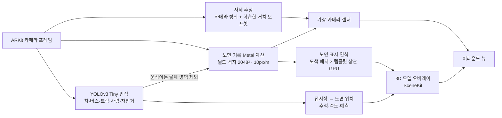
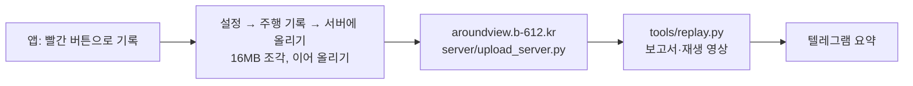

# 📱 phone-aroundview


차에 세로로 거치한 폰의 **앞 카메라 하나**로 어라운드 뷰 비슷한 화면을 만드는 시험 프로젝트입니다.
방금 앞에서 찍힌 노면은 곧 차 옆·뒤가 된다는 점을 이용해, 지나온 노면을 기억해 차 주변에 다시 그립니다.

> [!WARNING]
> 시험용입니다. 화면에 보이는 옆·뒤는 **과거 영상과 추정 위치**라서, 나중에 들어온 사람·차는 보이지 않습니다. 운전 보조 장치로 믿으면 안 됩니다.

---

## 🧭 iOS 앱 동작 방식



| 구성 | 내용 |
|---|---|
| 자세 | 폰은 차에 고정 → 차 방향 = 카메라 방위 + 고정 오프셋. 직진 중 이동 방향으로 오프셋 학습(폰이 비뚤게 거치돼도 보정) |
| 노면 기억 | 노면 격자 각 칸을 카메라에 투영해 색을 채움. 본넷 가림 영역·인식된 물체 상자는 기록 안 함 |
| 표시 방식 | 실사 / 가상(테슬라식, 아스팔트 + 차선 도색만) / 혼합 |
| 시점 | 위에서(정사영) / 뒤에서(원근), 두 손가락 확대 |
| 물체 | 상자 아래 가운데를 노면에 투영해 거리 계산, 최근접 연결로 추적, 시야 밖은 마지막 속도로 최대 3초 예측 후 서서히 사라짐 |
| 3D 모델 | 자차(흰색)·승용차·트럭·버스·오토바이·자전거·사람을 단색 3D 모델로 그림 (테슬라 화면 참고). 모델을 못 읽으면 상자로 대신 |
| 노면 표시 | 0.5초마다 차 앞뒤 12×36m 를 5px/m 도색 지도로 뽑아 화살표 6종·횡단보도·횡단보도 예고·정지선·자전거·양보 템플릿(±6°)과 정규화 상관. 차선 점선·실선은 방해 템플릿으로 걸러냄. 두 번 이상 맞은 것만 월드에 고정해 깨끗한 그림으로 그림 (가상·혼합 화면) |

---

## 🎥 주행 기록과 서버 재생 (0.3.0~)

화면만 보고는 원인을 알기 어려워서, 주행 원자료를 기록해 서버에서 같은 계산을 다시 돌려 봅니다.



| 파일 | 내용 |
|---|---|
| `video.mov` | 카메라 원본 (HEVC 1280×960, 5초 조각 기록이라 앱이 꺼져도 앞부분은 남음) |
| `frames.jsonl` | 프레임마다 ARKit 카메라 행렬(`T`, 열 우선)·내부 파라미터(`K`, 1920×1440 기준)·추적 상태·자차 자세·속도·방향 오프셋 |
| `motion.jsonl` / `gps.jsonl` | 100Hz 자세·자이로·가속도 / GPS 위치·속도·방향, 나침반 |
| `det.jsonl` / `marks.jsonl` | 물체 인식 상자(세로 화면 정규좌표)·노면 위치·추적 / 노면 표시 후보·고정 결과 |
| `events.jsonl` | 시작·끝·초기화·중단·추적 상태 변화·깃발(문제 지점) |
| `meta.json` | 기기·앱 버전·설정값(거치 높이 등)·`t0` |

모든 `t` 는 부팅 후 초(ARFrame.timestamp 와 같은 시계)이고, 영상 시각 = `t - t0` 입니다.

```bash
.venv/bin/python tools/replay.py data/sessions/<기록>          # → <기록>/analysis/
.venv/bin/python tools/make_fake_session.py /tmp/x/20260101_000000  # 가짜 기록 (계산 검증용)
```

재생 결과: `report.md`(추적·속도 오차·방향 보정·인식 수·깃발), `track.png`(ARKit 경로 vs GPS), `speed.png`, `replay.mp4`(카메라 | 노면 기억 탑뷰), `flag_<n>.jpg`, `overview.jpg`.

<details><summary>업로드 서버 운영</summary>

- 사용자 서비스 `aroundview-upload` (172.22.0.1:8945), 환경 `/vault/phone-aroundview/secrets.env` (`AV_UPLOAD_TOKEN`, 텔레그램 알림)
- NPM 호스트 `aroundview.b-612.kr` (Cloudflare 프록시 끔 — 100MB 제한·브라우저 검사 회피), 토큰 인증
- 받은 기록: `data/sessions/` (git 제외). 완료되면 `server/on_done.sh` 가 분석 후 텔레그램으로 보고

</details>

---

## 📂 구성

| 경로 | 설명 |
|---|---|
| `ios/AroundView/Core` | ARKit 세션·자세, 물체 인식·추적, 좌표 변환 |
| `ios/AroundView/Render` | Metal 셰이더(노면 기록·어라운드 뷰·미리보기)와 렌더러 |
| `ios/AroundView/UI` | SwiftUI 화면, 3D 모델 오버레이(SceneKit), 설정 |
| `ios/AroundView/Assets3D` | 3D 모델 가공본 (OBJ, `tools/build_assets.py` 가 만듦) |
| `ios/AroundView/RoadMarks` | 노면 표시 그림 가공본 (PNG + 실제 크기 `marks.json`) |
| `assets/source` | 내려받은 원본과 라이선스 — 출처는 [`assets/SOURCES.md`](assets/SOURCES.md) |
| `tools/build_assets.py` | 원본 → 앱용 가공 (모델 방향·크기·재질, SVG 자르기) |
| `tools/mark_match_sim.py` | 노면 표시 인식 시험 (가짜 노면에서 앱과 같은 계산) |
| `tools/replay.py` | 주행 기록 → 보고서·재생 영상 (앱의 노면 기억 계산을 numpy 로 재현) |
| `tools/make_fake_session.py` | 가짜 주행 기록 생성 (형식·계산 검증) |
| `server/` | 기록 업로드 수신 서버 + 완료 후 분석·알림 |
| `ios/project.yml` | XcodeGen 프로젝트 정의 (CI 에서 생성) |
| `aroundview.py` | 1단계 서버 시험: 녹화 영상 → 탑뷰 모자이크 (OpenCV) |

---

## 🚀 빌드와 배포

GitHub Actions(macOS)에서 빌드하고 TestFlight 로 올립니다.

```bash
gh workflow run ios.yml -f testflight=true
```

### 🏷️ 버전 관리

| 항목 | 규칙 |
|---|---|
| 앱 버전 | `ios/project.yml` 의 `MARKETING_VERSION` (x.y.z) — 설정 화면 맨 아래 '버전'에 표시 |
| 빌드 번호 | CI 실행 번호(`github.run_number`)가 자동으로 들어감 |
| 올리는 기준 | 새 기능·동작 변경 = 가운데(y), 버그 수정만 = 끝(z), 문구·배치·내부 정리 = 그대로 |
| 변경 기록 | `CHANGELOG.md` 에 `## x.y.z` 항목이 없으면 CI 가 TestFlight 업로드를 거부 (`ios/ci/check_version.py`) |
| 태그 | 업로드가 끝나면 CI 가 `vX.Y.Z-b빌드번호` 태그를 붙임 |

<details><summary>처음 한 번 필요한 준비</summary>

- 저장소 Secrets: `ASC_KEY_ID`, `ASC_ISSUER_ID`, `ASC_KEY_P8`, `APPLE_TEAM_ID`
- App Store Connect 에 번들 ID `kr.b-612.aroundview` 로 새 앱 만들기 (번들 ID 등록은 CI 가 처리)

</details>

<details><summary>1단계 영상 시험 (서버, aroundview.py)</summary>

1. 평면 노면 가정 역원근 변환 — 카메라 높이 `--h`(기본 1.2m), 화각 `--hfov_long`(65°), 수평선 `--vy`
2. 노면 영역(`--roi`, 본넷 위 띠)에서 옵티컬 플로우 → 노면 좌표로 투영 → RANSAC 강체 변환 = 자차 이동량
3. 폰이 틀어진 각도 자동 보정: 차는 옆으로 미끄러지지 않는다는 조건으로 소실점 x 탐색
4. 탑뷰 조각을 월드 모자이크에 누적 → 자차 중심 화면 (LIVE / MEMORY 영역)

```bash
python3 -m venv .venv && .venv/bin/pip install opencv-python-headless numpy
.venv/bin/python aroundview.py input.mov --out out
```

출력: `out_raw.mp4`(원본 | 어라운드 뷰), `out_mosaic.jpg`(전체 탑뷰 + 경로), `out_poses.json`

</details>

---

## ⚠️ 알려진 한계

- 카메라가 앞쪽 하나라 뒤·옆에서 다가오는 물체는 볼 수 없음
- 노면을 평평하다고 가정 → 높이 있는 물체는 늘어나 보임
- 거치 높이가 틀리면 거리 비율이 틀림 (설정에서 조정)
- 차 안에서 ARKit 추적이 흔들리면 노면 기록을 멈춤
- 서버 시험판은 회전 누적 오차로 긴 경로가 휘어짐 (차 주변 화면은 정상)
- 발열: 인식 주기를 온도에 따라 자동으로 낮춤
