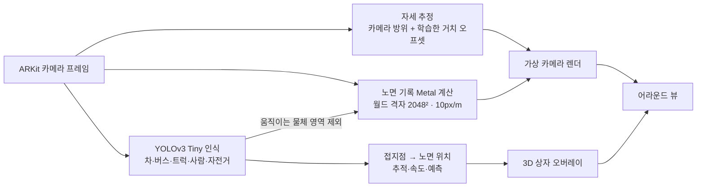

# 📱 phone-aroundview


차에 세로로 거치한 폰의 **앞 카메라 하나**로 어라운드 뷰 비슷한 화면을 만드는 시험 프로젝트입니다.
방금 앞에서 찍힌 노면은 곧 차 옆·뒤가 된다는 점을 이용해, 지나온 노면을 기억해 차 주변에 다시 그립니다.

> [!WARNING]
> 시험용입니다. 화면에 보이는 옆·뒤는 **과거 영상과 추정 위치**라서, 나중에 들어온 사람·차는 보이지 않습니다. 운전 보조 장치로 믿으면 안 됩니다.

---

## 🧭 iOS 앱 동작 방식



| 구성 | 내용 |
|---|---|
| 자세 | 폰은 차에 고정 → 차 방향 = 카메라 방위 + 고정 오프셋. 직진 중 이동 방향으로 오프셋 학습(폰이 비뚤게 거치돼도 보정) |
| 노면 기억 | 노면 격자 각 칸을 카메라에 투영해 색을 채움. 본넷 가림 영역·인식된 물체 상자는 기록 안 함 |
| 표시 방식 | 실사 / 가상(테슬라식, 아스팔트 + 차선 도색만) / 혼합 |
| 시점 | 위에서(정사영) / 뒤에서(원근), 두 손가락 확대 |
| 물체 | 상자 아래 가운데를 노면에 투영해 거리 계산, 최근접 연결로 추적, 시야 밖은 마지막 속도로 최대 3초 예측 후 서서히 사라짐 |

---

## 📂 구성

| 경로 | 설명 |
|---|---|
| `ios/AroundView/Core` | ARKit 세션·자세, 물체 인식·추적, 좌표 변환 |
| `ios/AroundView/Render` | Metal 셰이더(노면 기록·어라운드 뷰·미리보기)와 렌더러 |
| `ios/AroundView/UI` | SwiftUI 화면, 3D 상자 오버레이, 설정 |
| `ios/project.yml` | XcodeGen 프로젝트 정의 (CI 에서 생성) |
| `aroundview.py` | 1단계 서버 시험: 녹화 영상 → 탑뷰 모자이크 (OpenCV) |

---

## 🚀 빌드와 배포

GitHub Actions(macOS)에서 빌드하고 TestFlight 로 올립니다.

```bash
gh workflow run ios.yml -f testflight=true
```

<details><summary>처음 한 번 필요한 준비</summary>

- 저장소 Secrets: `ASC_KEY_ID`, `ASC_ISSUER_ID`, `ASC_KEY_P8`, `APPLE_TEAM_ID`
- App Store Connect 에 번들 ID `kr.b-612.aroundview` 로 새 앱 만들기 (번들 ID 등록은 CI 가 처리)

</details>

<details><summary>1단계 영상 시험 (서버, aroundview.py)</summary>

1. 평면 노면 가정 역원근 변환 — 카메라 높이 `--h`(기본 1.2m), 화각 `--hfov_long`(65°), 수평선 `--vy`
2. 노면 영역(`--roi`, 본넷 위 띠)에서 옵티컬 플로우 → 노면 좌표로 투영 → RANSAC 강체 변환 = 자차 이동량
3. 폰이 틀어진 각도 자동 보정: 차는 옆으로 미끄러지지 않는다는 조건으로 소실점 x 탐색
4. 탑뷰 조각을 월드 모자이크에 누적 → 자차 중심 화면 (LIVE / MEMORY 영역)

```bash
python3 -m venv .venv && .venv/bin/pip install opencv-python-headless numpy
.venv/bin/python aroundview.py input.mov --out out
```

출력: `out_raw.mp4`(원본 | 어라운드 뷰), `out_mosaic.jpg`(전체 탑뷰 + 경로), `out_poses.json`

</details>

---

## ⚠️ 알려진 한계

- 카메라가 앞쪽 하나라 뒤·옆에서 다가오는 물체는 볼 수 없음
- 노면을 평평하다고 가정 → 높이 있는 물체는 늘어나 보임
- 거치 높이가 틀리면 거리 비율이 틀림 (설정에서 조정)
- 차 안에서 ARKit 추적이 흔들리면 노면 기록을 멈춤
- 서버 시험판은 회전 누적 오차로 긴 경로가 휘어짐 (차 주변 화면은 정상)
- 발열: 인식 주기를 온도에 따라 자동으로 낮춤
